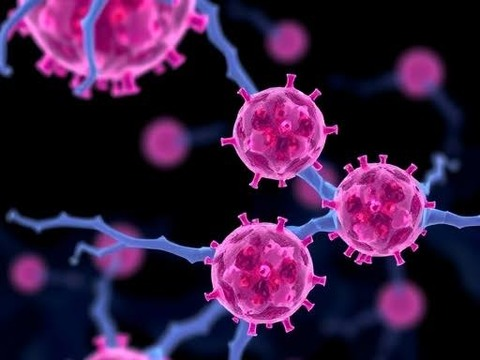
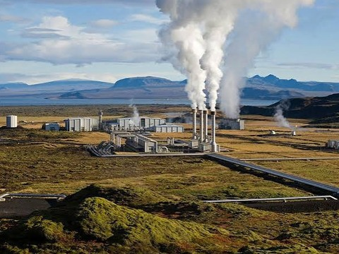

::::: {.site-page .site-research}

::: {.site-heading}
# Research
:::

::: {.site-research-overview}
I study how clinical, environmental, and social factors shape health outcomes. I have broad research interests acorss biostatistical methods, cancer & environment epidemiology, and health economics. I aim to inform treatment heterogeneity, prognostic prediction, and early intervention under different subgroups.
:::

:::: {.site-grid .site-research-grid}

::: {.site-research-theme}

  

## Survival Analysis and Causal Machine Learning

I compared regression and machine learning models for predicting breast cancer survival using cancer registry data. Building on this work, I want to develop methods for estimating how survival benefits from cancer treatments vary by comorbidity and access to care. The goal is to inform treatment decisions for patients who face barriers to specialist care.

:::

::: {.site-research-theme}

  

## Cancer Screening and Health Economics

I used decision models to compare the lifetime costs and health outcomes of colorectal cancer screening strategies. I want to study whether screening subsidies and insurance coverage improve both initial screening and diagnostic follow-up after a positive result, then incorporate those findings into economic evaluations. This work would help policymakers assess which strategies offer good value and reach people facing financial barriers.

:::

::: {.site-research-theme}

  

## Environmental and Mental Health Epidemiology

I linked early-life air pollution data with mental health records to support research on schizophrenia risk in Chile. I want to examine how environmental exposures and social adversity jointly shape mental health risk during sensitive developmental periods. This work would help public health agencies decide where and when to prioritize exposure reduction and mental health support.

:::

::: {.site-research-theme}

  

## Network Analysis

I used network analysis to examine how symptoms of anxiety and depression, loneliness, and behavioral factors were connected among U.S. college students during the COVID-19 pandemic. I want to use repeated assessments to investigate which symptoms tend to precede worsening mental health and whether these patterns differ across student groups. This work would help campus health services decide which symptoms to monitor and when to offer early support.

:::

::::

:::::